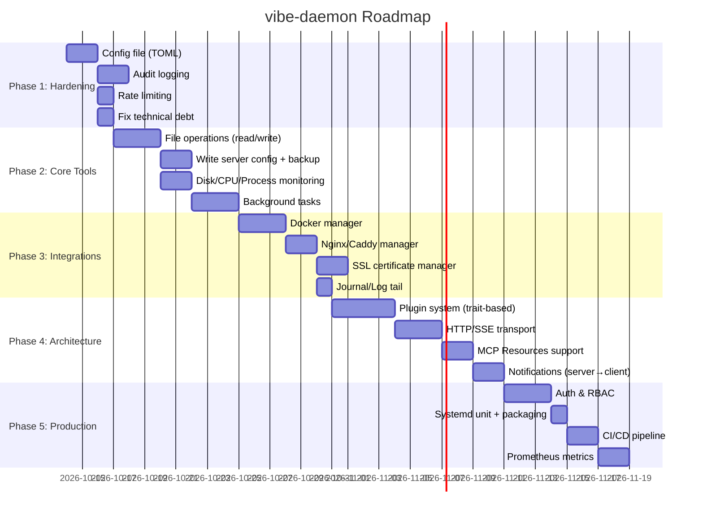

# 🔬 Анализ проекта vibe-daemon — Полный Разбор и Дорожная Карта

## 📊 Текущее состояние проекта

### Что уже есть (и сделано хорошо)

| Компонент | Файл | Оценка | Комментарий |
|---|---|---|---|
| **MCP Protocol** | [`protocol.rs`](src/mcp/protocol.rs) | ⭐⭐⭐⭐ | Чистые JSON-RPC 2.0 типы, правильные error codes |
| **MCP Dispatcher** | [`mcp/mod.rs`](src/mcp/mod.rs) | ⭐⭐⭐⭐ | Корректный stdio-цикл, маршрутизация всех 5 tools |
| **Guard Engine** | [`firewall.rs`](src/guard/firewall.rs) | ⭐⭐⭐⭐⭐ | Отличная фильтрация: fork-bombs, rm -rf, SSH, dd, mkfs |
| **Port Arbitration** | [`firewall.rs`](src/guard/firewall.rs) | ⭐⭐⭐⭐ | Умный поиск альтернативных портов |
| **Inspector** | [`sys.rs`](src/inspector/sys.rs) | ⭐⭐⭐⭐ | Парсинг ss, /proc/meminfo, path traversal защита |
| **Smart Logs** | [`logger.rs`](src/executor/logger.rs) | ⭐⭐⭐⭐⭐ | Дедупликация, сжатие успешного вывода, извлечение паник |
| **Тесты** | [`integration_test.rs`](tests/integration_test.rs) | ⭐⭐⭐⭐⭐ | Полный stdio e2e тест, 46+ тестов |
| **CLI** | [`main.rs`](src/main.rs) | ⭐⭐⭐⭐ | Чистый, clap-парсинг, tracing в stderr |

> [!TIP]
> **Общий вердикт**: Крепкий, хорошо спроектированный MVP. Архитектура модульная, Guard Engine реально работает, Smart Logs экономят токены, тесты покрывают все ключевые сценарии.

---

## 🔴 Критические доработки (Приоритет 1 — безопасность и надёжность)

### 1. 🔐 Конфигурационный файл вместо хардкода
Сейчас все политики безопасности жёстко зашиты в код. Для production нужен `config.toml` / `config.yaml`:

```toml
[security]
protected_ports = [22, 2222]
protected_services = ["vibe-daemon", "sshd", "ssh", "NetworkManager"]
command_timeout_secs = 30
max_output_bytes = 1_048_576  # 1MB

[allowed_config_dirs]
paths = ["/etc/nginx", "/etc/caddy", "/etc/supervisor", "/etc/haproxy"]

[guard]
deny_patterns_file = "/etc/vibe-daemon/deny_patterns.txt"
allow_shutdown = false
allow_reboot = false
```

**Зачем**: На разных серверах разные SSH-порты (2222, 2200), разные критические сервисы.

### 2. 🛡️ Rate Limiting и Abuse Protection
Нет никакой защиты от спама команд. AI-модель может бесконечно вызывать `execute_safe_command`:

```rust
// Нужно добавить в McpDispatcher:
pub struct McpDispatcher {
    rate_limiter: Arc<RateLimiter>,  // max 60 calls / minute
    command_history: Arc<Mutex<VecDeque<CommandRecord>>>,
}
```

### 3. 🔒 Аутентификация и авторизация
Сейчас кто угодно может подключиться к stdio-демону. Для remote-режима (HTTP/SSE/WebSocket) нужна хотя бы:
- **Token-based auth** (Bearer token в заголовке или в `initialize` params)
- **RBAC**: роли `read-only` (только `get_system_status`) vs `admin` (все инструменты)

### 4. 📝 Аудит-лог (Audit Trail)
Каждый вызов инструмента должен записываться в неизменяемый лог:

```json
{"ts": "2026-10-13T23:00:00Z", "tool": "execute_safe_command", "args": {"command": "rm -rf target"}, "result": "ok", "client": "claude-desktop", "duration_ms": 450}
```

**Зачем**: Если AI наделал дел — нужно понять что именно и в каком порядке.

---

## 🟡 Расширение функционала (Приоритет 2 — новые инструменты)

### 5. 📁 `write_server_config` — Безопасная запись конфигов
Сейчас AI может только *читать* конфиги. Для полноценного управления нужна запись:

```
Tool: write_server_config
Args: { path: "/etc/nginx/sites-enabled/myapp.conf", content: "...", backup: true }
```

- Автоматический бэкап перед записью (`nginx.conf.bak.2026-10-13T23:00:00`)
- Валидация синтаксиса перед записью (`nginx -t`, `caddy validate`)
- Откат при неудачной валидации

### 6. 📂 `file_operations` — Файловая система
```
Tool: list_directory      → ls -la с пагинацией
Tool: read_file           → безопасное чтение с лимитом размера
Tool: write_file          → запись с бэкапом
Tool: search_files        → grep/find с ограничением глубины
Tool: tail_logs           → хвост лог-файла (последние N строк)
```

### 7. 🐳 `docker_manager` — Управление контейнерами
```
Tool: docker_ps           → список контейнеров
Tool: docker_logs         → логи контейнера (со smart compression!)
Tool: docker_restart      → перезапуск контейнера
Tool: docker_compose_up   → запуск docker-compose стека
Tool: docker_stats        → метрики CPU/RAM контейнеров
```

### 8. 🌐 `nginx_manager` / `caddy_manager` — Управление веб-сервером
```
Tool: nginx_test_config   → nginx -t
Tool: nginx_reload        → безопасный reload после проверки
Tool: nginx_list_sites    → список виртуальных хостов
Tool: nginx_enable_site   → симлинк в sites-enabled
```

### 9. 📊 `monitoring` — Расширенный мониторинг
```
Tool: get_disk_usage      → df -h + du для больших директорий
Tool: get_cpu_info        → /proc/stat, loadavg
Tool: get_top_processes   → top-N по CPU/RAM
Tool: get_network_stats   → rx/tx bytes, connections count
Tool: get_journal_logs    → journalctl с фильтрацией по unit/time
```

### 10. 🔑 `ssl_manager` — Управление SSL-сертификатами
```
Tool: ssl_check_expiry    → проверка сроков всех сертификатов
Tool: ssl_certbot_renew   → certbot renew с уведомлением
Tool: ssl_list_certs      → список установленных сертификатов
```

### 11. 👤 `user_manager` — Управление пользователями
```
Tool: list_users          → /etc/passwd, last login
Tool: list_ssh_keys       → authorized_keys для пользователей
Tool: check_sudo_access   → кто имеет sudo
```

---

## 🟢 Архитектурные улучшения (Приоритет 3 — масштабируемость)

### 12. 🌐 HTTP/SSE транспорт (помимо stdio)
Сейчас только stdio — это блокирует удалённое использование без SSH-обёртки:

```rust
// main.rs
match cli.transport {
    Transport::Stdio => dispatcher.run_stdio().await,
    Transport::Http { port } => dispatcher.run_http(port).await,
    Transport::Sse { port } => dispatcher.run_sse(port).await,
}
```

MCP спецификация 2024-11-05 поддерживает **Streamable HTTP** — это основной путь для remote-сценария.

### 13. 🔌 Plugin System — Модульные инструменты
Вместо хардкода всех tools в `mcp/mod.rs`, нужна trait-based система:

```rust
#[async_trait]
pub trait McpTool: Send + Sync {
    fn name(&self) -> &str;
    fn description(&self) -> &str;
    fn input_schema(&self) -> Value;
    async fn execute(&self, args: Value, ctx: &ToolContext) -> CallToolResult;
}

// Регистрация:
dispatcher.register_tool(Box::new(SystemStatusTool));
dispatcher.register_tool(Box::new(DockerManagerTool));
dispatcher.register_tool(Box::new(NginxManagerTool));
```

### 14. 🧠 Stateful Session / Контекст сессии
Сейчас `McpDispatcher` stateless. Для продвинутых сценариев нужен контекст:

```rust
pub struct SessionContext {
    pub client_info: ImplementationInfo,
    pub started_at: Instant,
    pub command_history: Vec<CommandRecord>,
    pub active_background_tasks: HashMap<String, TaskHandle>,
}
```

### 15. 🔄 Background Tasks / Long-running Commands
`execute_safe_command` имеет 30-секундный таймаут. Для `cargo build`, `npm install`, `docker build` нужны фоновые задачи:

```
Tool: start_background_task  → запуск длительной команды
Tool: check_task_status      → проверка статуса (running/done/failed)
Tool: get_task_output        → получение последних N строк вывода
Tool: cancel_task            → отмена фоновой задачи
```

### 16. 📡 Notifications / Server-Initiated Events
MCP поддерживает server → client уведомления. Демон может:
- Уведомлять о критическом использовании памяти (>90%)
- Сообщать о завершении фоновых задач
- Алертить при падении ключевых сервисов
- Уведомлять об истечении SSL-сертификатов

### 17. 🗃️ Resources (MCP Resources)
MCP протокол поддерживает `resources/list` и `resources/read`. Демон может публиковать:
- `system://status` — текущее состояние системы
- `config://nginx/nginx.conf` — конфигурации как ресурсы
- `log://nginx/access.log` — логи как ресурсы с подпиской

---

## 🔵 Quality of Life (Приоритет 4 — удобство)

### 18. 📦 Systemd Unit файл
```ini
[Unit]
Description=vibe-daemon MCP Server
After=network.target

[Service]
Type=simple
ExecStart=/usr/local/bin/vibe-daemon --log-file /var/log/vibe-daemon.log
Restart=always
RestartSec=5

[Install]
WantedBy=multi-user.target
```

### 19. 🏗️ CI/CD Pipeline
- GitHub Actions: build + test + clippy + fmt на каждый PR
- Cross-compilation для aarch64 (ARM серверы)
- Автоматическая сборка `.deb`/`.rpm` пакетов
- Docker образ для быстрого деплоя

### 20. 📈 Prometheus Metrics
Экспорт метрик для мониторинга самого демона:
```
vibe_daemon_tool_calls_total{tool="execute_safe_command"} 142
vibe_daemon_security_violations_total{type="destructive_command"} 3
vibe_daemon_command_duration_seconds{tool="execute_safe_command"} 0.45
```

### 21. 🧩 Graceful Shutdown & Signal Handling
Сейчас демон завершается только при закрытии stdin. Нужна обработка SIGTERM/SIGINT:
- Завершение текущих команд
- Запись финального аудит-лога
- Cleanup временных файлов

---

## 🏗️ Мелкие баги и технический долг

| # | Проблема | Файл | Строка |
|---|---|---|---|
| 1 | `SERVER_VERSION` захардкожена как `"0.1.0"` вместо `env!("CARGO_PKG_VERSION")` | [`mcp/mod.rs`](src/mcp/mod.rs#L14) | 14 |
| 2 | `default_allowed_dirs()` содержит только `/etc/nginx` — слишком узко | [`sys.rs`](src/inspector/sys.rs#L333-L346) | 333 |
| 3 | `find_alternative_port` может вернуть уже занятый порт в fallback-ветке | [`firewall.rs`](src/guard/firewall.rs#L295-L299) | 295 |
| 4 | Нет ограничения размера читаемого файла в `safe_read_config_file` | [`sys.rs`](src/inspector/sys.rs#L374-L442) | 374 |
| 5 | `check_single_subcommand` стрипает `sudo` только один раз (не рекурсивно) | [`firewall.rs`](src/guard/firewall.rs#L119-L127) | 119 |
| 6 | Нет лимита на размер stdout/stderr в `execute_command_with_smart_logs` | [`runner.rs`](src/executor/runner.rs#L8-L45) | 8 |
| 7 | `key_services` в `collect_system_status` захардкожен на 3 сервиса | [`sys.rs`](src/inspector/sys.rs#L313) | 313 |

---

## 📋 Рекомендуемый порядок реализации



---

## 💡 Что ещё нужно для **полноценного** AI-управления сервером?

> [!IMPORTANT]
> Текущий демон решает ~30% задач серверного администрирования. Вот что нужно для полноты:

| Категория | Что есть ✅ | Что нужно ❌ |
|---|---|---|
| **Выполнение команд** | Safe execute, Guard, Timeout | Background tasks, Streaming output, Working directory |
| **Файловая система** | Read config | Write config, List/Search/Create/Delete, Permissions |
| **Мониторинг** | Memory, Ports, Uptime | CPU, Disk, Processes, GPU, Network IO |
| **Логи** | Smart compression | Journal/syslog reader, Log tail/follow, Log search |
| **Сервисы** | Status/Restart/Reload | Start/Stop/Enable/Disable, Create systemd unit |
| **Сеть** | Port management | DNS, Firewall rules listing, VPN status, Interfaces |
| **Контейнеры** | — | Docker/Podman full lifecycle |
| **Веб-серверы** | — | Nginx/Caddy/Apache config management |
| **Базы данных** | — | PostgreSQL/MySQL status, backup, query |
| **SSL/TLS** | — | Certbot, cert expiry, auto-renew |
| **Пакеты** | — | apt/dnf install/update, vulnerability scan |
| **Git/Deploy** | — | Git operations, CI/CD trigger, rollback |
| **Бэкапы** | — | Создание, расписание, восстановление |
| **Безопасность** | Command blocklist | fail2ban, UFW listing, auth logs, SSH key management |
| **Транспорт** | stdio | HTTP/SSE, WebSocket, Remote access |
| **Аутентификация** | — | Token auth, RBAC, Multi-tenant |

> [!NOTE]
> Ключевое преимущество vibe-daemon — это **не просто прокси к shell**, а **интеллектуальный слой безопасности**. Каждый новый инструмент должен проходить через Guard Engine и Smart Log Engine. Это философская основа проекта, и её нужно сохранить.
